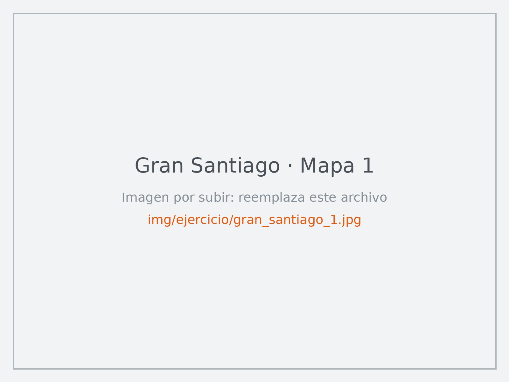
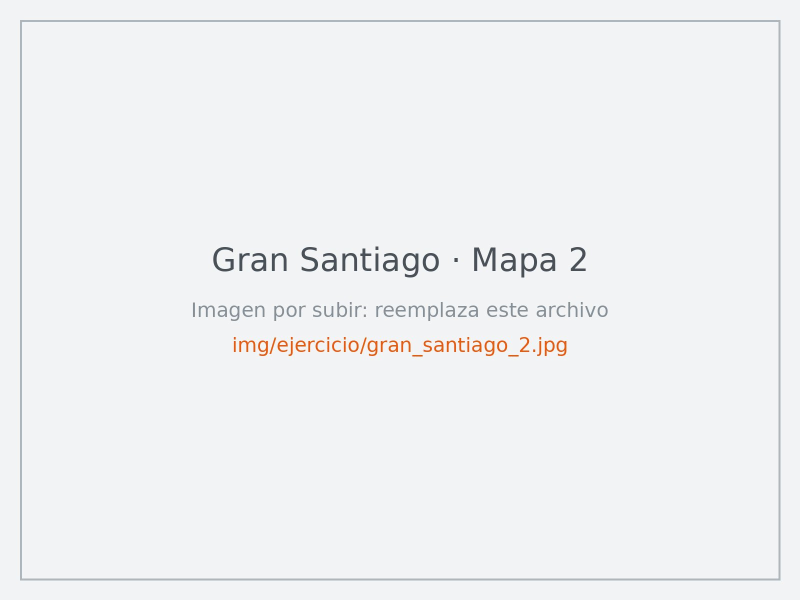
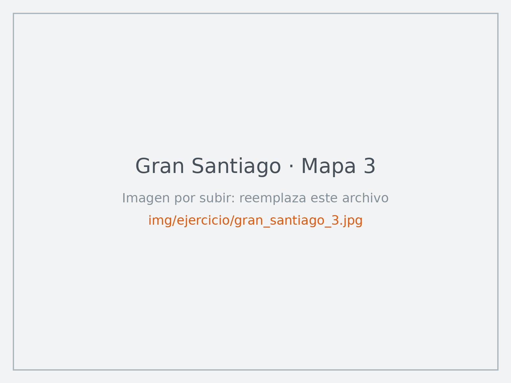
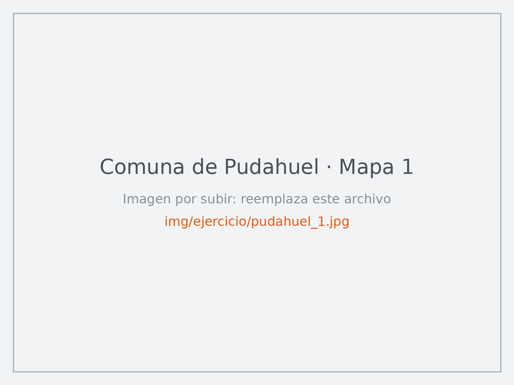
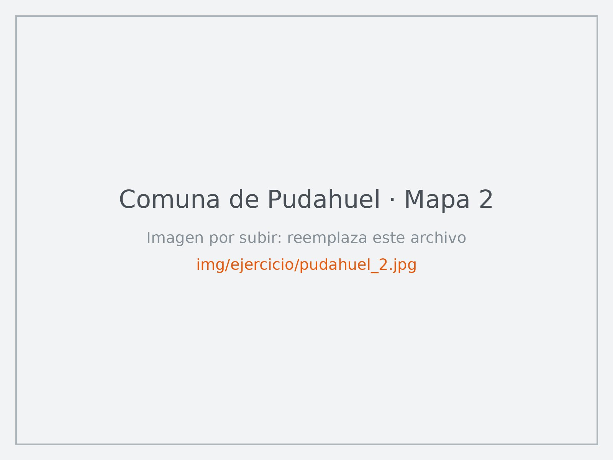
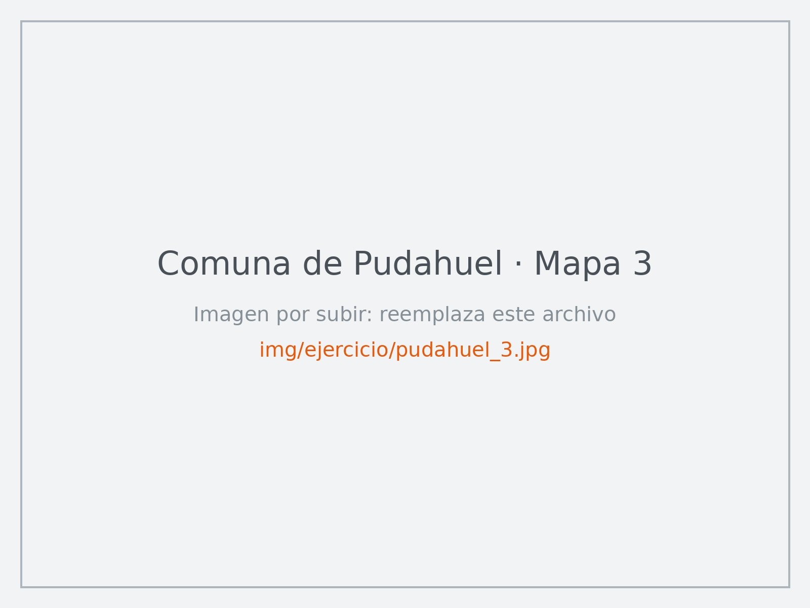

Lo que viene después de la clase tiene tres partes. Solo la primera se entrega.

| | Qué es | ¿Se entrega? |
|---|---|---|
| [**1 · Ejercicio aplicado**](#ejercicio-aplicado) | Analizar críticamente dos cartografías: una del Gran Santiago y una de Pudahuel | **Sí**, por correo |
| [**2 · Recurso: CensoLab**](#recurso-censolab) | Explorar mapas del Censo y hacerle preguntas a una plataforma web | No |
| [**3 · Desafío para seguir aprendiendo**](#desafio) | Construir tu propio mapa de cualquier territorio con Colab + Gemini | Opcional |

## 1 · Ejercicio aplicado: leer críticamente una cartografía {#ejercicio-aplicado}

::: {.callout-important}
## Entrega
**Fecha:**  · **Trabajo:** individual · **Enviar a:** [](mailto:) con el asunto *«Ejercicio cartografía – Apellido Nombre»* · **Formato sugerido:** PDF o Word de 2 a 3 páginas, con los dos mapas que elegiste.
:::

En clase hicimos mapas. Ahora toca **leerlos**: mirar qué muestran, sospechar de lo que no muestran y preguntarse para qué sirven. No necesitas programar ni producir mapas nuevos.

### Qué tienes que hacer

1. Escoge **un mapa del Gran Santiago** de los tres de abajo.
2. Escoge **un mapa de la comuna de Pudahuel** de los tres de abajo. Puede ser la **misma variable** o una distinta.
3. Analiza críticamente ambos mapas siguiendo el [recorrido de preguntas guía](#preguntas-guia). Puedes apoyarte en datos, noticias, estudios o fenómenos conocidos (cita tus fuentes).
4. Compara las dos escalas: ¿qué aporta cada una?
5. Envía tu análisis al correo del docente.

### Los mapas

Haz clic en un mapa para verlo en grande. Todos son cartografías **por manzana censal** del Censo 2024.

#### Gran Santiago

::: {.panel-tabset}

### 

{.lightbox group="gran-santiago"}

[Descargar mapa](img/ejercicio/gran_santiago_1.jpg){download="gran_santiago_1.jpg" .btn .btn-outline-secondary .btn-sm}

### 

{.lightbox group="gran-santiago"}

[Descargar mapa](img/ejercicio/gran_santiago_2.jpg){download="gran_santiago_2.jpg" .btn .btn-outline-secondary .btn-sm}

### 

{.lightbox group="gran-santiago"}

[Descargar mapa](img/ejercicio/gran_santiago_3.jpg){download="gran_santiago_3.jpg" .btn .btn-outline-secondary .btn-sm}

:::

#### Comuna de Pudahuel

::: {.panel-tabset}

### 

{.lightbox group="pudahuel"}

[Descargar mapa](img/ejercicio/pudahuel_1.jpg){download="pudahuel_1.jpg" .btn .btn-outline-secondary .btn-sm}

### 

{.lightbox group="pudahuel"}

[Descargar mapa](img/ejercicio/pudahuel_2.jpg){download="pudahuel_2.jpg" .btn .btn-outline-secondary .btn-sm}

### 

{.lightbox group="pudahuel"}

[Descargar mapa](img/ejercicio/pudahuel_3.jpg){download="pudahuel_3.jpg" .btn .btn-outline-secondary .btn-sm}

:::

### Preguntas guía: un recorrido en seis pasos {#preguntas-guia}

Las preguntas avanzan como un recorrido: parten de **lo que se ve**, pasan por **lo que el mapa oculta**, cambian de **escala**, buscan los **factores** y los **actores** que explican el patrón y terminan en un **análisis integral**. No tienes que responderlas todas: úsalas como hilo conductor de tu texto.

::: {.ruta}

::: {.paso-ruta}
[1]{.ruta-num}

#### Observar: ¿qué se ve? {.ruta-tit}

- ¿Hay **patrones de distribución**? Concentraciones, gradientes (centro–periferia, oriente–poniente), corredores, bordes marcados o "islas".
- ¿Qué **contrastes** aparecen entre zonas vecinas? ¿Hay comportamientos llamativos o excepciones?
- ¿Coincide el patrón con elementos que conoces del territorio: ejes viales, cerros, ríos, el aeropuerto, poblaciones, villas, condominios, zonas industriales?

[Ya describiste el patrón. Antes de explicarlo, pregúntate cuánto puedes confiar en lo que ves.]{.ruta-puente}
:::

::: {.paso-ruta}
[2]{.ruta-num}

#### Sospechar: ¿qué NO se ve? {.ruta-tit}

- **Por la estructura de la pregunta censal:** ¿cómo se preguntó?, ¿es autodeclarado?, ¿quién respondió?, ¿qué momento captura el Censo?
- **Por la composición de la variable:** ¿qué cuenta el numerador?, ¿contra qué total se compara?, ¿qué categorías agrupa o deja fuera?
- **Por la unidad y el diseño del mapa:** manzanas de distinto tamaño y densidad, manzanas sin datos o excluidas, cortes de la clasificación, colores.
- ¿Qué aspectos del fenómeno **no mide** el Censo (calidad, trayectorias, percepciones, relaciones)?

[Lo que se ve y lo que se oculta también depende de desde dónde miras.]{.ruta-puente}
:::

::: {.paso-ruta}
[3]{.ruta-num}

#### Cambiar de escala: ¿qué aporta cada mirada? {.ruta-tit}

- ¿Qué diferencia hay entre mostrar el fenómeno en el **Gran Santiago** y en **Pudahuel**? ¿Qué aporta cada escala?
- ¿Se ve en el mapa metropolitano lo que aparece en el mapa comunal? ¿Qué se pierde y qué se gana al acercarse o alejarse?
- ¿Cómo se ve Pudahuel en relación con su entorno metropolitano?

[Con el patrón claro en ambas escalas, toca preguntarse por qué el territorio es así. Empieza por el soporte físico.]{.ruta-puente}
:::

::: {.paso-ruta}
[4]{.ruta-num}

#### Los factores: el medio físico y ambiental {.ruta-tit}

El medio ambiente no es un actor, pero sí un **factor** que condiciona dónde se puede vivir, hacia dónde crece la ciudad y con qué consecuencias.

- ¿Qué condiciones del territorio podrían ayudar a explicar el patrón: **relieve y cerros, ríos y esteros, humedales, suelos agrícolas, disponibilidad de agua, clima**?
- ¿**Hacia dónde crece la ciudad** y sobre qué suelos? ¿Qué se pierde cuando se urbaniza un borde rural o un humedal?
- ¿Qué **riesgos** y molestias ambientales se distribuyen en el territorio: inundaciones, remoción en masa, incendios, islas de calor, contaminación del aire, ruido (por ejemplo, del aeropuerto), cercanía a industrias o vertederos?
- ¿Quiénes viven más expuestos a esos riesgos y quiénes en los entornos más favorables? ¿Qué **consecuencias** tiene eso para cada grupo?
- ¿Es el entorno el que explica la localización de los grupos, o los grupos con más recursos eligen los mejores entornos?

[Los factores condicionan, pero no deciden solos: alguien decide cómo y para quién se usa ese territorio.]{.ruta-puente}
:::

::: {.paso-ruta}
[5]{.ruta-num}

#### Los actores: ¿quién ordena el territorio? {.ruta-tit}

Viendo y analizando las distintas distribuciones, fenómenos y grupos dentro del territorio, según tu opinión y análisis:

- ¿**Quién ordena** el territorio?
- ¿Quién **planifica** dónde debe ir cada cosa, con o sin instrumentos de planificación (planes reguladores, políticas de vivienda, decisiones de inversión)?
- ¿Cuáles son los **actores** que hacen que el territorio se organice de esa forma (Estado, municipios, mercado inmobiliario, empresas, organizaciones, las propias comunidades)?
- ¿Por qué tienden a **armarse grupos** ordenados de esa forma?
- ¿Cómo se relacionan esas decisiones con los factores ambientales del paso anterior: quién decide urbanizar zonas de riesgo, y quién termina viviendo en ellas?

[Ahora junta las piezas.]{.ruta-puente}
:::

::: {.paso-ruta .ruta-final}
[6]{.ruta-num}

#### Síntesis: un análisis integral {.ruta-tit}

Integra los pasos anteriores en una interpretación propia:

- **Patrón + límites + escala + factores + actores:** ¿por qué el territorio que observaste se organiza así?
- ¿Qué **preguntas** permite responder este análisis y qué preguntas **nuevas** abre?
- ¿A quién le podría servir (política pública, organizaciones territoriales, investigación) y con qué otra información o método lo complementarías (trabajo de campo, entrevistas, otras fuentes)?
:::

:::

### Estructura sugerida

Tu texto puede seguir el mismo recorrido:

1. **Los mapas que elegiste** y por qué.
2. **Lo que se ve:** patrones, contrastes y excepciones, en ambos mapas.
3. **Lo que no se ve:** límites de la pregunta, de la variable y de la representación.
4. **Comparación de escalas:** qué aporta el Gran Santiago y qué aporta Pudahuel.
5. **Factores ambientales:** condiciones del medio, crecimiento de la ciudad, riesgos y consecuencias.
6. **Actores:** quién ordena el territorio y por qué se forman esos grupos.
7. **Síntesis integral:** tu interpretación final y las preguntas que abre.
8. **Referencias**, si usaste datos o fuentes externas (APA 7.ª edición).

### Qué se valorará

| Criterio | Qué se espera |
|---|---|
| Observación | Describe patrones concretos, con lugares identificables en el mapa |
| Lectura crítica | Distingue lo que el mapa muestra de lo que no puede mostrar, y explica por qué (pregunta, variable, unidad, diseño) |
| Comparación de escalas | Explica qué aporta y qué oculta cada escala, con ejemplos de los mapas |
| Factores ambientales | Relaciona el patrón con condiciones del medio físico, riesgos y sus consecuencias para distintos grupos |
| Actores y ordenamiento | Reflexiona, con argumentos propios, sobre quiénes y qué procesos organizan el territorio de esa forma |
| Síntesis integral | Integra observación, límites, escala, factores y actores en una interpretación coherente, y plantea preguntas pertinentes |
| Fundamentación y claridad | Se apoya en datos o fenómenos conocidos citados; escribe con claridad |

## 2 · Recurso: explorar con CensoLab {#recurso-censolab}

[CensoLab](http://censolab.cl) es una plataforma abierta para explorar datos geográficos y censales de Chile, desarrollada por Joshua Kunst y Matías Parra ([presentación en el grupo de usuari@s de R de Santiago](https://santiagorusers.github.io/posts/2026-08-26/)). Permite hacer **mapas interactivos**, revisar **perfiles territoriales** y hacerle **preguntas en lenguaje natural** a un asistente de inteligencia artificial, que responde con mapas, gráficos y tablas.

No se entrega nada: es un recurso para seguir explorando. Algunas ideas:

- **Busca la variable que elegiste** en el ejercicio 1 y mírala en CensoLab. CensoLab trabaja con datos públicos agregados (por ejemplo, por comuna), no por manzana: ¿qué cambia respecto de los mapas por manzana?
- **Compara Pudahuel con sus comunas vecinas** o con el promedio regional.
- **Pregúntale al asistente**, por ejemplo: *«¿Qué comunas de la Región Metropolitana tienen mayor proporción de personas de 60 años o más?»* Luego verifica la respuesta en el mapa o la tabla que entrega.
- **Míralo críticamente**, como en clase: ¿qué unidad territorial usa?, ¿qué indicador?, ¿cómo clasifica los colores?, ¿de dónde vienen los datos?

::: {.callout-tip}
Lo que encuentres en CensoLab puede servirte como dato de apoyo en el ejercicio 1. Si lo usas, cítalo.
:::

## 3 · Desafío para seguir aprendiendo: tu propio mapa con Colab + Gemini {#desafio}

¿Te quedaste con ganas de hacer tu propio mapa? Con un notebook de Google Colab y el asistente Gemini puedes cartografiar **cualquier variable del Censo 2024**, en **cualquier región, provincia o comuna de Chile**, sin programar: respondes unas preguntas con tus palabras y Gemini te entrega una línea lista para ejecutar.

[Ver el desafío](desafio-colab.qmd){.btn .btn-warning role="button"}
[Guía ilustrada de Colab y Gemini](guia-colab.qmd){.btn .btn-outline-secondary role="button"}

Es opcional y no forma parte de la evaluación. Si lo haces, puedes usar tu mapa como complemento en el ejercicio 1.
