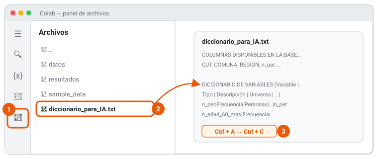
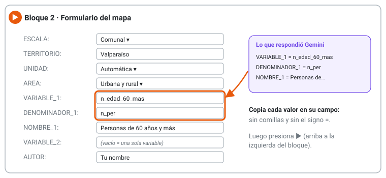

{fig-alt="Recorrido en cinco pasos: habilitar Colab, Bloque 1, Gemini, Bloque 2, mapa y gráfico"}

## Antes de empezar: tres ideas

::: {.grid}
::: {.g-col-12 .g-col-md-4}
::: {.tarjeta}
**🍳 Colab es una cocina equipada**

Tú traes la receta (el notebook) y Google pone la cocina: el computador que hace los cálculos está en la nube. Por eso **no instalas nada** y funciona incluso en un computador antiguo.
:::
:::
::: {.g-col-12 .g-col-md-4}
::: {.tarjeta}
**📓 Un notebook es un cuaderno**

Mezcla texto explicativo con **bloques** (o celdas) de código. Cada bloque se **ejecuta** por separado con el botón ▶, de arriba hacia abajo, como seguir una receta en orden.
:::
:::
::: {.g-col-12 .g-col-md-4}
::: {.tarjeta}
**✦ Gemini es un asistente, no un oráculo**

Es la inteligencia artificial de Google. Te ayuda a **traducir tu pregunta** al lenguaje del Censo, pero puede equivocarse. La última palabra siempre es tuya.
:::
:::
:::

::: {.callout-tip}
## Lo que necesitas
✅ Una **cuenta personal de Gmail** (las institucionales a veces tienen Colab o Gemini bloqueados) · ✅ El navegador **Chrome** · ✅ **30 minutos** y una conexión a internet estable
:::

## Paso 1 · Habilitar Colab en tu Google Drive

*Se hace una sola vez. Si ya usaste Colab antes, salta al paso 2.*

Colab es una "aplicación" que se conecta a tu Google Drive, igual que Documentos o Planillas. Hay que activarla:

1. Entra a [Google Drive](https://drive.google.com/) con tu cuenta.
2. Haz clic en **+ Nuevo**, luego en **Más** y luego en **Conectar más aplicaciones**.

{fig-alt="Menú de Google Drive: Nuevo, Más, Conectar más aplicaciones"}

3. En la tienda que se abre, escribe **Colaboratory** en el buscador.
4. Haz clic en la tarjeta de Colaboratory y luego en **Instalar**. Acepta los permisos con tu cuenta.

{fig-alt="Tienda de aplicaciones: buscar Colaboratory y presionar Instalar"}

::: {.callout-note}
## ¿Cómo sé que funcionó?
Vuelve a **+ Nuevo → Más**: ahora aparece **Google Colaboratory** en la lista.
:::

## Paso 2 · Abrir el notebook y guardar tu copia

1. Haz clic aquí: [Abrir el notebook de la tarea en Colab](https://colab.research.google.com/github/USUARIO/REPOSITORIO/blob/main/codigo/tarea_cartografia.ipynb){.btn .btn-warning .btn-sm role="button"}
2. Ve al menú **Archivo → Guardar una copia en Drive**.

{fig-alt="Menú Archivo de Colab con la opción Guardar una copia en Drive"}

::: {.callout-note}
## ¿Cómo sé que funcionó?
Se abre una pestaña nueva y el título dice **«Copia de tarea_cartografia.ipynb»**. Trabaja siempre en esa pestaña: la otra puedes cerrarla.
:::

## Paso 3 · Ejecutar el Bloque 1

El Bloque 1 descarga los datos del Censo y prepara todo. **No tienes que cambiar nada**: solo ejecutarlo.

1. Pasa el mouse sobre el bloque: a la izquierda aparece el botón **▶**. Haz clic.
2. Espera. Mientras trabaja, el botón gira. La primera vez tarda **1 a 3 minutos**.
3. Cuando termina aparece un **✓** verde y, debajo, el texto **«Listo»** con las regiones, provincias y columnas disponibles.

{fig-alt="Un bloque antes, durante y después de ejecutarse"}

La primera vez, Colab mostrará esta advertencia. Es normal: aparece con cualquier notebook que no fue creado por Google. Presiona **Ejecutar de todos modos**.

{fig-alt="Advertencia: Este notebook no fue creado por Google, con el botón Ejecutar de todos modos"}

::: {.callout-warning}
## Si el bloque muestra un error de descarga
Google limita las descargas cuando muchas personas bajan los datos al mismo tiempo. Mira la sección [Si la descarga falla](#si-la-descarga-falla), al final de esta guía.
:::

## Paso 4 · Copiar el diccionario para Gemini

El Bloque 1 dejó un archivo de texto llamado **`diccionario_para_IA.txt`**. Contiene la lista de columnas del Censo con su descripción, su **universo** (a quién se refiere: personas, hogares o viviendas) y un **denominador sugerido** para calcular porcentajes. Es lo que Gemini necesita para ayudarte bien.

1. En la barra de la izquierda, haz clic en el ícono de **carpeta 📁**.
2. Haz **doble clic** en `diccionario_para_IA.txt`: se abre a la derecha.
3. Haz clic dentro del texto, selecciona todo con **Ctrl + A** (en Mac, **Cmd + A**) y cópialo con **Ctrl + C** (**Cmd + C**).

{fig-alt="Panel de archivos de Colab con diccionario_para_IA.txt abierto"}

## Paso 5 · Conversar con Gemini

1. Arriba a la derecha de Colab, haz clic en **✦ Gemini**. Se abre un chat al costado del notebook.
2. Copia el **[prompt tipo](04-tarea.qmd#prompt-tipo-para-gemini)** de la tarea, completa lo que está entre corchetes (tu pregunta, escala y territorio) y pégalo en el chat. Al final, pega el diccionario que copiaste en el paso 4. Presiona **Enter**.
3. Gemini responde con un bloque de valores (`ESCALA = …`, `VARIABLE_1 = …`) y una justificación.

{fig-alt="Panel de Gemini con el prompt y la respuesta con los valores del formulario"}

::: {.callout-tip}
## Si no ves el botón Gemini
Abre [gemini.google.com](https://gemini.google.com/) en otra pestaña con la misma cuenta. Funciona igual y, además, permite **adjuntar archivos**: puedes subir `diccionario_para_IA.txt` (clic derecho sobre el archivo en Colab → **Descargar**) en vez de pegarlo.
:::

### Cómo conversar bien con Gemini

Gemini no es un buscador: es una **conversación**. Su primera respuesta es un punto de partida. Algunas preguntas útiles para continuar:

| Si quieres… | Escríbele algo como… |
|---|---|
| Entender la propuesta | *«¿Por qué elegiste ese denominador y no otro?»* |
| Explorar alternativas | *«Dame dos variables alternativas para mi pregunta y explica qué mide cada una.»* |
| Revisar un posible error | *«¿El numerador y el denominador tienen el mismo universo?»* |
| Simplificar | *«Explícame esta variable como se la explicarías a alguien sin formación técnica.»* |

::: {.callout-warning}
## Tres cuidados con la IA
1. **Verifica** que cada nombre de variable aparezca en el diccionario. Gemini a veces inventa nombres que suenan bien.
2. **No compartas datos personales** (tuyos ni de terceros) en el chat.
3. **Guarda la conversación** (copia el texto en un documento): la necesitas para el anexo de uso de IA del informe.
:::

## Paso 6 · Completar el formulario del Bloque 2

El Bloque 2 se ve como un **formulario**: campos de texto y listas desplegables. No tienes que tocar código.

1. Copia cada valor que te dio Gemini en el campo con el mismo nombre: **sin comillas y sin el signo =**.
2. Si quieres un mapa de **una sola variable**, deja vacía la `VARIABLE_2`.
3. Escribe tu nombre en `AUTOR`: aparecerá en la fuente del mapa.
4. Presiona **▶** en el Bloque 2.

{fig-alt="Formulario del Bloque 2 con los valores copiados desde Gemini"}

::: {.callout-note}
## Si te equivocas al escribir
No pasa nada. El bloque revisa los nombres y, si alguno no existe, te muestra un aviso con los nombres más parecidos (por ejemplo: *«¿Quisiste decir: VALPARAÍSO?»*). Las tildes y las mayúsculas no importan. Corrige y vuelve a presionar ▶.
:::

## Paso 7 · Tus resultados

En 1 o 2 minutos aparecen, debajo del bloque, el **mapa** y el **gráfico**, y se descargan solos a tu computador.

{fig-alt="Dos archivos descargados: mapa y gráfico en JPEG"}

¿Quieres probar otra variable u otro territorio? Cambia el formulario y ejecuta **solo el Bloque 2** las veces que quieras. El Bloque 1 se vuelve a ejecutar únicamente si Colab se desconectó.

## Problemas frecuentes

| Lo que ves | Qué significa | Qué hacer |
|---|---|---|
| «Sesión desconectada» o «Volver a conectar» | Colab apaga la "cocina" tras un rato sin uso | Ejecuta de nuevo el Bloque 1 y luego el Bloque 2 |
| `NameError: name 'CATALOGO' is not defined` | Ejecutaste el Bloque 2 sin el Bloque 1 | Ejecuta primero el Bloque 1 |
| «No encontré '…' en la escala …» | El territorio está mal escrito o no corresponde a esa escala | Usa una de las sugerencias del aviso |
| «El campo variable 1: '…' no existe» | Gemini o tú escribieron un nombre que no está en la base | Copia el nombre exacto desde el diccionario |
| «Solo hay N unidades con datos» | Muy pocas comunas para clasificar | Cambia `UNIDAD` a *Manzana* o elige una escala mayor |
| No se descargan los archivos | El navegador bloqueó las descargas | Acepta «Permitir varias descargas» o búscalos en 📁 → `resultados` (clic derecho → Descargar) |

### Si la descarga falla

1. Abre la [carpeta de datos del docente](https://drive.google.com/drive/folders/1qzYq0RzuFlMieopEV03JyfpTOxxxWjij) y descarga los archivos.
2. En tu Google Drive, dentro de **Mi unidad**, crea una carpeta llamada **`censo2024`** y sube ahí los archivos.
3. Ejecuta de nuevo el Bloque 1. Te pedirá permiso para acceder a tu Drive: acéptalo.

## Pequeño glosario

**Notebook (cuaderno):** documento que mezcla texto y código. · **Bloque (celda):** cada caja del notebook que se ejecuta por separado. · **Ejecutar:** pedirle al computador que haga lo que dice un bloque (botón ▶). · **Sesión o entorno de ejecución:** el computador prestado por Google mientras trabajas; se apaga si no lo usas. · **Prompt:** la instrucción que le escribes a la IA. · **Denominador:** el total contra el que comparas (por ejemplo, el total de personas) para obtener un porcentaje.
