::: {.light-content}
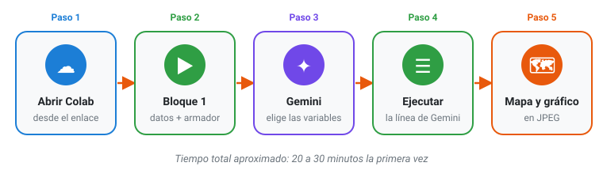{fig-alt="Recorrido en cinco pasos: abrir Colab, bloques 1 a 3, Gemini (bloque 4), tu mapa (bloque 5), resultados"}
:::

::: {.dark-content}
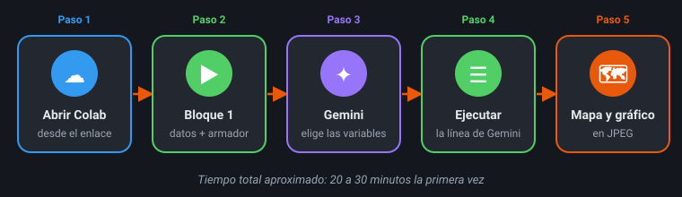{fig-alt="Recorrido en cinco pasos: abrir Colab, bloques 1 a 3, Gemini (bloque 4), tu mapa (bloque 5), resultados"}
:::

## Antes de empezar: tres ideas

::: {.grid}
::: {.g-col-12 .g-col-md-4}
::: {.tarjeta}
**🍳 Colab es una cocina equipada**

Tú traes la receta (el notebook) y Google pone la cocina: el computador que hace los cálculos está en la nube. Por eso **no instalas nada** y funciona incluso en un computador antiguo.
:::
:::
::: {.g-col-12 .g-col-md-4}
::: {.tarjeta}
**📓 Un notebook es un cuaderno**

Mezcla texto explicativo con **bloques** (o celdas) de código. Cada bloque se **ejecuta** por separado con el botón ▶, de arriba hacia abajo, como seguir una receta en orden.
:::
:::
::: {.g-col-12 .g-col-md-4}
::: {.tarjeta}
**✦ Gemini es un asistente, no un oráculo**

Es la inteligencia artificial de Google. Te ayuda a **traducir tu pregunta** al lenguaje del Censo, pero puede equivocarse. La última palabra siempre es tuya.
:::
:::
:::

::: {.callout-tip}
## Lo que necesitas
✅ Una **cuenta personal de Gmail** (las institucionales a veces tienen Colab o Gemini bloqueados) · ✅ El navegador **Chrome** · ✅ **30 minutos** y una conexión a internet estable
:::

## Paso 1 · Abrir el notebook y guardar tu copia

1. Haz clic aquí: [Abrir el notebook de la tarea en Colab](https://colab.research.google.com/github/USUARIO/REPOSITORIO/blob/main/codigo/desafio_cartografia.ipynb){.btn .btn-warning .btn-sm role="button"} Si te lo pide, inicia sesión con tu cuenta de Gmail.
2. Ve al menú **Archivo → Guardar una copia en Drive**.

::: {.light-content}
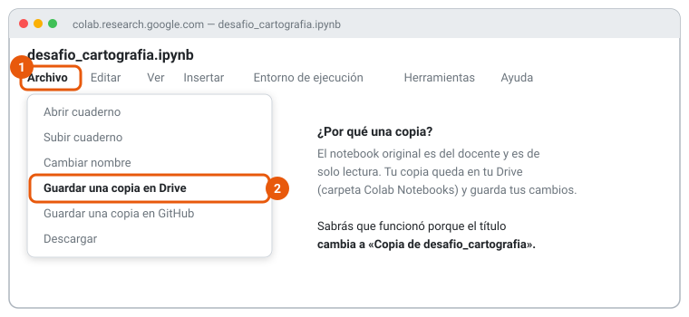{fig-alt="Menú Archivo de Colab con la opción Guardar una copia en Drive"}
:::

::: {.dark-content}
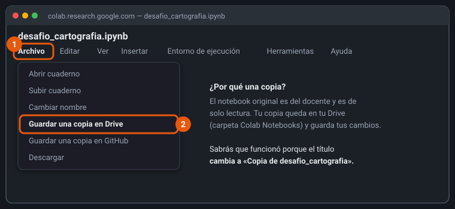{fig-alt="Menú Archivo de Colab con la opción Guardar una copia en Drive"}
:::

::: {.callout-note}
## ¿Cómo sé que funcionó?
Se abre una pestaña nueva y el título dice **«Copia de desafio_cartografia.ipynb»**. Trabaja siempre en esa pestaña: la otra puedes cerrarla.
:::

::: {.callout-warning collapse="true"}
## ¿El enlace no abre el notebook? Habilita Colab en tu Drive (solo si hace falta)
Algunas cuentas necesitan activar Colab una vez, como una "aplicación" de Google Drive:

1. Entra a [Google Drive](https://drive.google.com/) y haz clic en **+ Nuevo → Más → Conectar más aplicaciones**.
2. Busca **Colaboratory**, haz clic en su tarjeta y luego en **Instalar**. Acepta los permisos.
3. Vuelve a hacer clic en **Abrir en Colab**.

::: {.light-content}
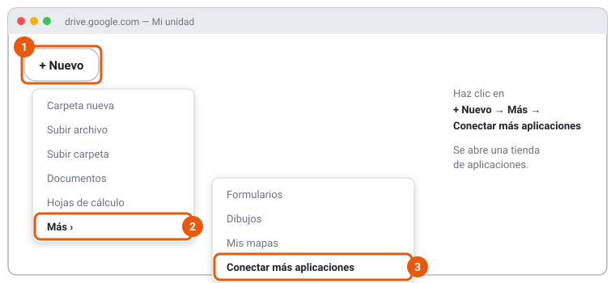{fig-alt="Menú de Google Drive: Nuevo, Más, Conectar más aplicaciones"}
:::

::: {.dark-content}
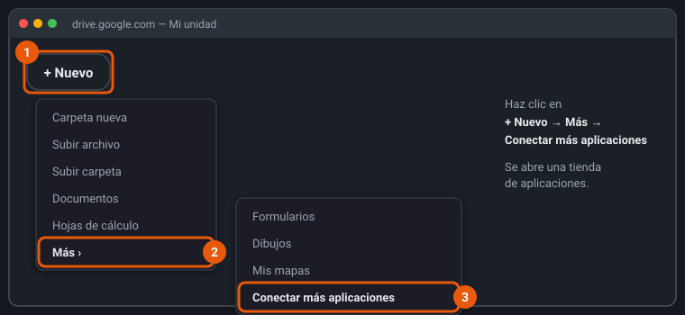{fig-alt="Menú de Google Drive: Nuevo, Más, Conectar más aplicaciones"}
:::

::: {.light-content}
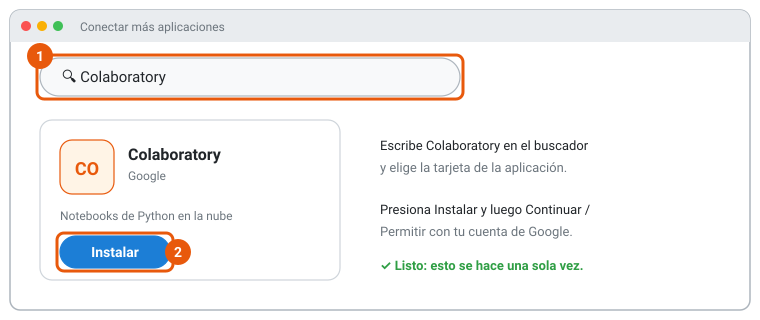{fig-alt="Tienda de aplicaciones: buscar Colaboratory y presionar Instalar"}
:::

::: {.dark-content}
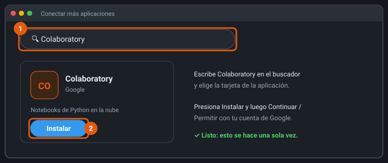{fig-alt="Tienda de aplicaciones: buscar Colaboratory y presionar Instalar"}
:::

:::

## Paso 2 · Preparar: bloques 1, 2 y 3

El notebook está ordenado en **7 bloques**, de arriba hacia abajo. Cada uno tiene arriba una tarjeta que dice **qué hace, qué debes ver y cuánto tarda**. Los tres primeros preparan todo: **no tienes que cambiar nada**, solo ejecutarlos en orden.

| Bloque | Qué hace | Tiempo |
|:--:|---|:--:|
| 1 | Prepara Colab | 30 s |
| 2 | Descarga los datos del Censo | 1–3 min |
| 3 | Prepara el diccionario y la herramienta de mapas | 10 s |

1. Pasa el mouse sobre el **Bloque 1**: a la izquierda aparece el botón **▶**. Haz clic.
2. Espera el recuadro **verde** («Bloque 1 listo») y repite con el **Bloque 2** y el **Bloque 3**.
3. Si te saltas un bloque, no pasa nada: el siguiente te avisará con un recuadro amarillo cuál falta.

::: {.light-content}
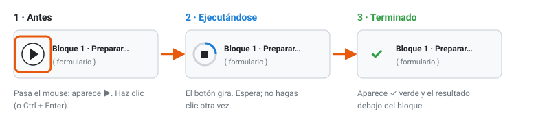{fig-alt="Un bloque antes, durante y después de ejecutarse"}
:::

::: {.dark-content}
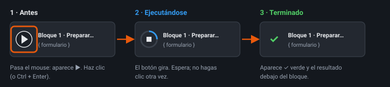{fig-alt="Un bloque antes, durante y después de ejecutarse"}
:::

La primera vez, Colab mostrará esta advertencia. Es normal: aparece con cualquier notebook que no fue creado por Google. Presiona **Ejecutar de todos modos**.

::: {.light-content}
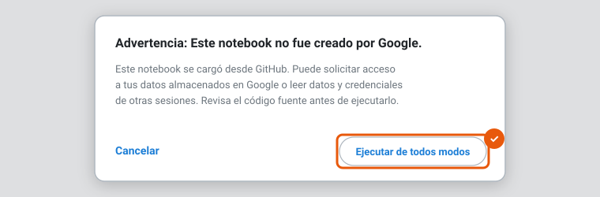{fig-alt="Advertencia: Este notebook no fue creado por Google, con el botón Ejecutar de todos modos"}
:::

::: {.dark-content}
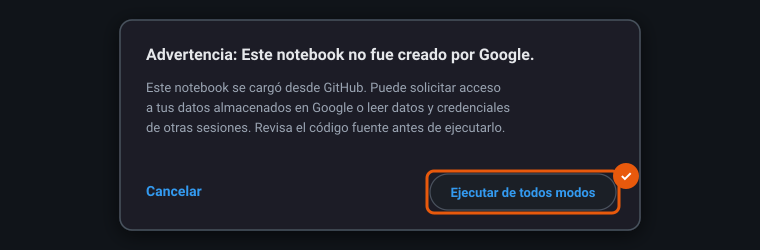{fig-alt="Advertencia: Este notebook no fue creado por Google, con el botón Ejecutar de todos modos"}
:::

::: {.callout-warning}
## Si el bloque muestra un error al descargar los datos
Google limita las descargas cuando muchas personas bajan los datos al mismo tiempo. Mira [Si la descarga falla](#si-la-descarga-falla).
:::

## Paso 3 · Armar el mensaje y conversar con Gemini

Todo ocurre **dentro de Colab**: no necesitas otra pestaña ni adjuntar archivos.

1. Ejecuta el **Bloque 4**: aparece el **armador del mensaje para Gemini**. Responde con tus palabras: **qué quieres mapear** (o toca una de las 23 ideas), **dónde**, si lo quieres **cruzar con otro tema**, tu pregunta (opcional) y **tu nombre**.
2. Presiona **📋 Copiar mensaje para Gemini**. El mensaje ya incluye el diccionario de variables y los códigos de los territorios.

::: {.light-content}
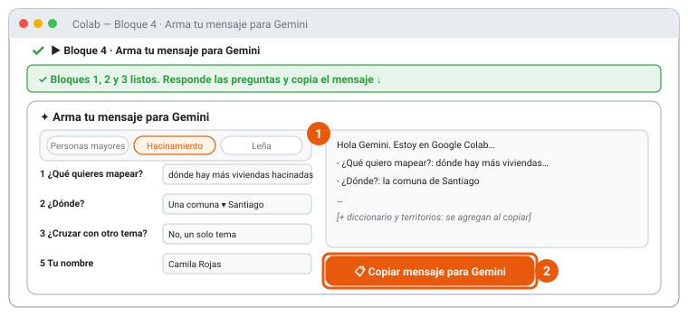{fig-alt="Armador del mensaje para Gemini con ideas, preguntas y botón Copiar"}
:::

::: {.dark-content}
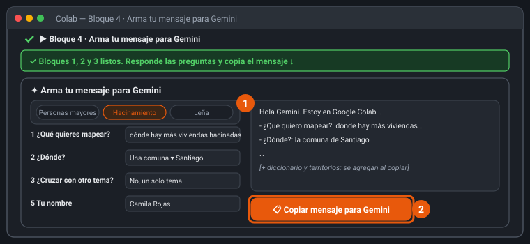{fig-alt="Armador del mensaje para Gemini con ideas, preguntas y botón Copiar"}
:::

3. Haz clic en **✦ Gemini**, arriba a la derecha de Colab: se abre un chat al costado. Pega el mensaje (**Ctrl + V**) y presiona **Enter**.
4. Gemini responde en tres partes: **lo que entendió** (confirma que es lo que querías), **una línea** `hacer_mapa(...)` lista para ejecutar y una **explicación simple**. Si no entendió bien, díselo con tus palabras y pídele que corrija la línea.

::: {.light-content}
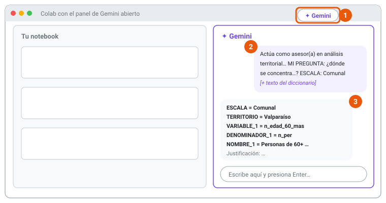{fig-alt="Panel de Gemini en Colab con la respuesta en tres partes"}
:::

::: {.dark-content}
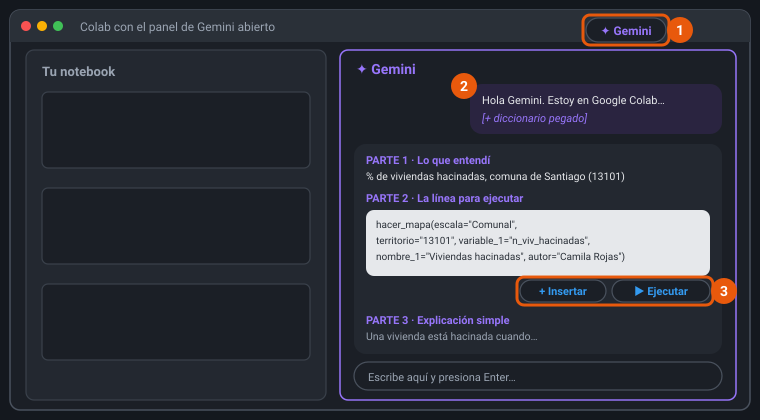{fig-alt="Panel de Gemini en Colab con la respuesta en tres partes"}
:::

::: {.callout-tip}
## Si no ves el botón Gemini en Colab
Abre [gemini.google.com](https://gemini.google.com/) en otra pestaña y pega el mismo mensaje: también funciona. Luego copia la línea `hacer_mapa(...)` de vuelta en Colab (paso 4). ¿Buscas otras variables? Hay 189: pregúntale a Gemini *«Con este diccionario, muéstrame todas las variables sobre [tema] y explícamelas en simple»* o revisa las [ideas de variables](desafio-colab.qmd#ideas-de-variables-para-mapear).
:::

### Cómo conversar bien con Gemini

Gemini no es un buscador: es una **conversación**. Su primera respuesta es un punto de partida. Algunas preguntas útiles para continuar:

| Si quieres… | Escríbele algo como… |
|---|---|
| Entender la propuesta | *«¿Por qué elegiste ese denominador y no otro?»* |
| Explorar alternativas | *«Dame dos variables alternativas para mi pregunta y explica qué mide cada una.»* |
| Revisar un posible error | *«¿El numerador y el denominador tienen el mismo universo?»* |
| Simplificar | *«Explícame esta variable como se la explicarías a alguien sin formación técnica.»* |

::: {.callout-warning}
## Cuatro cuidados con la IA
1. **Verifica** en la Parte 1 que entendió bien el tema y el territorio. Gemini puede equivocarse o inventar nombres.
2. Si Gemini propone escribir **otro código** (instalar cosas, cargar datos, hacer su propio mapa), no lo ejecutes: pídele solo la línea `hacer_mapa(...)`.
3. **No compartas datos personales** (tuyos ni de terceros) en el chat.
4. **Guarda la conversación** (copia el texto en un documento): la necesitas para el anexo de uso de IA del informe.
:::

## Paso 4 · Tu mapa: Bloque 5

1. En el **Bloque 5**, borra la línea de ejemplo y **pega la línea** `hacer_mapa(...)` que te dio Gemini. Presiona **▶**.
2. Si Gemini te muestra un botón para usar el código (**▶ Ejecutar** o **+ Insertar**), también puedes usarlo: hace lo mismo.
3. Lee los recuadros de colores: **verde** confirma el territorio, **azul** te dice qué se completó solo y **amarillo** te dice qué revisar.
4. ¿Aún no tienes tu línea? Presiona ▶ igual: el Bloque 5 trae un **ejemplo** para que veas cómo funciona.

::: {.light-content}
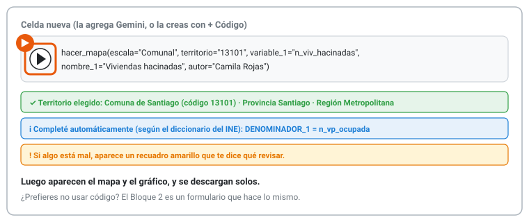{fig-alt="Celda con hacer_mapa y recuadros verde, azul y amarillo"}
:::

::: {.dark-content}
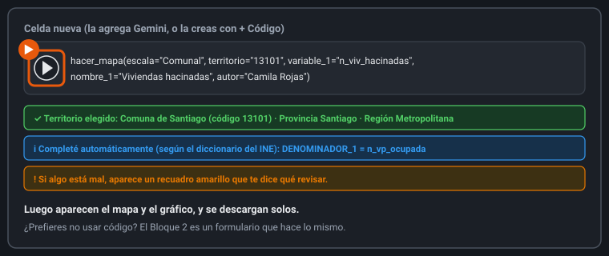{fig-alt="Celda con hacer_mapa y recuadros verde, azul y amarillo"}
:::

::: {.callout-note}
## ¿Prefieres no ejecutar código del chat?
El **Bloque 6** es un formulario que hace exactamente lo mismo: copia en cada campo los valores de la línea de Gemini (sin comillas) y presiona ▶. Solo son obligatorios los campos marcados con ★. Si un recuadro amarillo te pide corregir algo, cópiale el mensaje a Gemini y pídele la línea corregida.
:::

## Paso 5 · Tus resultados

En 1 o 2 minutos aparecen, debajo del bloque, el **mapa** y el **gráfico**, y se descargan solos a tu computador.

::: {.light-content}
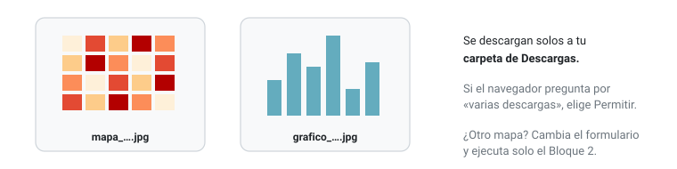{fig-alt="Dos archivos descargados: mapa y gráfico en JPEG"}
:::

::: {.dark-content}
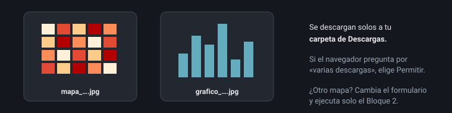{fig-alt="Dos archivos descargados: mapa y gráfico en JPEG"}
:::

¿Quieres probar otra variable u otro territorio? Pega otra línea en el **Bloque 5** y vuelve a presionar ▶, las veces que quieras. Al final, el **Bloque 7** descarga todos tus mapas juntos en un zip. Los bloques 1 a 3 se vuelven a ejecutar solo si Colab se desconectó.

## Problemas frecuentes

| Lo que ves | Qué significa | Qué hacer |
|---|---|---|
| «Sesión desconectada» o «Volver a conectar» | Colab apaga la "cocina" tras un rato sin uso | Ejecuta de nuevo los bloques 1 a 3 y luego tu línea |
| `NameError: name 'hacer_mapa' is not defined` | Colab se reinició o no ejecutaste los bloques 1 a 3 | Ejecútalos y luego vuelve a ejecutar tu línea |
| Recuadro amarillo «No encontré '…' en la escala …» | El territorio está mal escrito o no corresponde a esa escala | Usa una de las sugerencias o escribe el código |
| Recuadro amarillo «El campo variable 1: '…' no existe» | Gemini escribió un nombre que no está en la base | Cópiale el recuadro a Gemini y pídele la línea corregida |
| Gemini escribe mucho código o instala paquetes | Se salió de la instrucción | No lo ejecutes. Escríbele: «Solo dame la línea hacer_mapa(...)» |
| Recuadro amarillo «Ojo: este nombre también existe en otro nivel» | Hay una comuna, provincia o región con el mismo nombre (no es un error) | Revisa el recuadro verde; si no es lo que querías, cambia `ESCALA` o escribe el código |
| Recuadro amarillo «Solo hay N unidades con datos» | Muy pocas comunas para clasificar | Agrega `unidad="Manzana"` a la línea o elige una escala mayor |
| No se descargan los archivos | El navegador bloqueó las descargas | Acepta «Permitir varias descargas» o búscalos en 📁 → `resultados` (clic derecho → Descargar) |

### Si la descarga falla

1. Abre la [carpeta de datos del docente](https://drive.google.com/drive/folders/1qzYq0RzuFlMieopEV03JyfpTOxxxWjij) y descarga los archivos.
2. En tu Google Drive, dentro de **Mi unidad**, crea una carpeta llamada **`censo2024`** y sube ahí los archivos.
3. Ejecuta de nuevo el Bloque 2. Te pedirá permiso para acceder a tu Drive: acéptalo.

## Pequeño glosario

**Notebook (cuaderno):** documento que mezcla texto y código. · **Bloque (celda):** cada caja del notebook que se ejecuta por separado. · **Ejecutar:** pedirle al computador que haga lo que dice un bloque (botón ▶). · **Sesión o entorno de ejecución:** el computador prestado por Google mientras trabajas; se apaga si no lo usas. · **Prompt:** la instrucción que le escribes a la IA. · **Denominador:** el total contra el que comparas (por ejemplo, el total de personas) para obtener un porcentaje.
