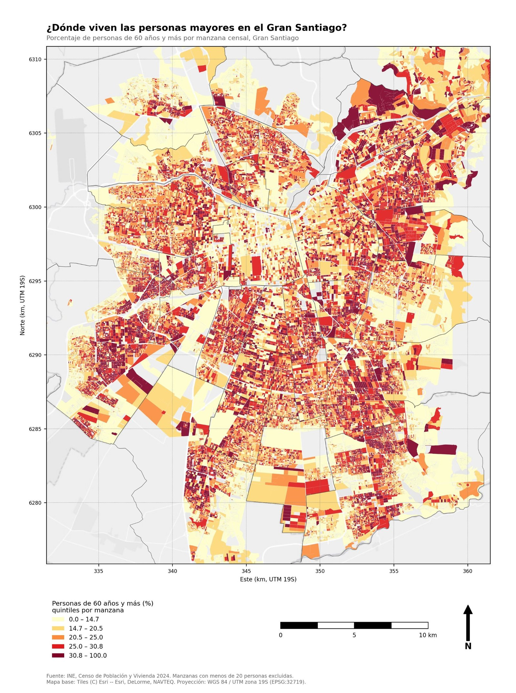
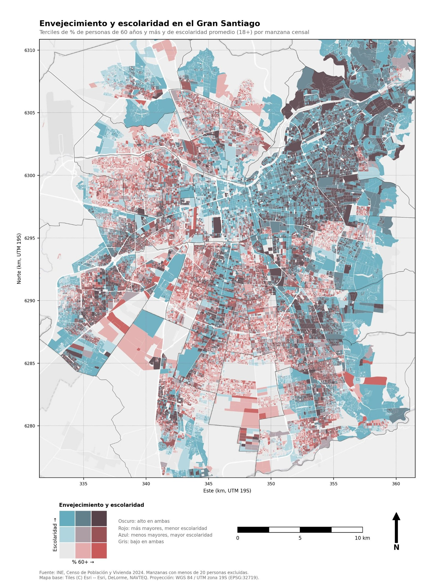
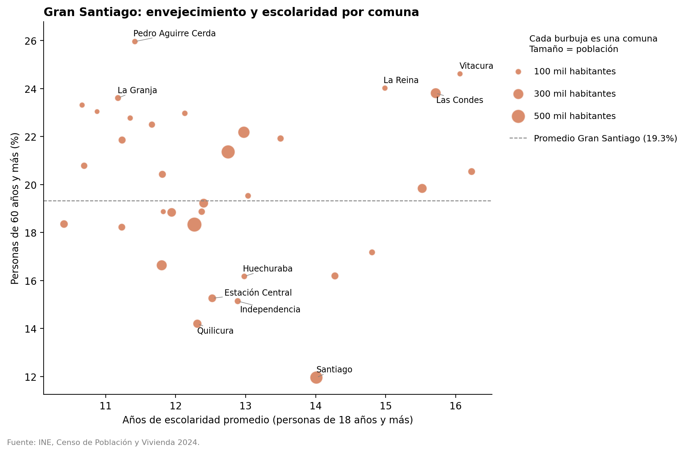

::: {.pregunta}
**Pregunta guía:** ¿dónde se concentran las personas mayores (60 años y más) en el Gran Santiago, y qué patrón territorial muestran?
:::

Esta clase introduce el uso de **mapas como herramienta de análisis cuantitativo**. No se requiere experiencia previa en sistemas de información geográfica (SIG) ni en programación espacial.

El área de estudio es el **Gran Santiago**: las 32 comunas de la Provincia de Santiago, más Puente Alto y San Bernardo. Usamos el umbral de 60 años porque es la definición legal de persona mayor en Chile (Ley 19.828) y porque la base por manzana del Censo 2024 trae la variable `n_edad_60_mas`.

::: {.docente}
**Magíster en Metodologías Críticas para la Investigación Social**\
Clase del 21 de octubre de 2026

**Docente:** Benjamín Julio\
Ingeniería Civil en Geografía · Minor en Ciencia de Datos\
Universidad de Santiago de Chile
:::

## Del territorio al dato

::: {.capsula}
Mi camino empezó en la geografía, aprendiendo a leer el territorio como algo más que el fondo donde ocurren las cosas. Después llegaron los datos: programar en Python y R me permitió pasar de mirar mapas a construirlos, y de construirlos a preguntarles por qué dicen lo que dicen.

Desarrollando plataformas geoespaciales para instituciones públicas, y ordenando información espacial dispersa para que otros puedan usarla, aprendí que un mapa nunca es neutral. Decidir qué se mide, a qué escala y con qué colores también es decidir qué se ve y qué queda fuera.

Esa tensión atraviesa mi trabajo sobre movilidad y vulnerabilidad urbana, y me acompañará en un observatorio municipal, donde los datos territoriales terminan convertidos en decisiones sobre personas.

Hoy les propongo recorrer ese mismo camino en dos horas: partir de una base censal, convertirla en mapas y, sobre todo, aprender a sospechar de ellos.
:::

## Qué vamos a hacer

1. **Entender** los conceptos mínimos para trabajar con datos espaciales: datos e información, datum, coordenadas, proyecciones, modelos de datos y SIG.
2. **Procesar** la cartografía del Censo 2024 en Python: filtrar el Gran Santiago, calcular una tasa y agregarla por comuna.
3. **Visualizar** el fenómeno en un gráfico, en mapas interactivos y en mapas estáticos por manzana, incluido un **mapa bivariado** que cruza envejecimiento y escolaridad.
4. **Exportar** los resultados a distintos formatos: HTML, PNG/JPG, Shapefile, GeoPackage y KMZ (Google Earth).
5. **Comunicar y criticar**: qué hace profesional a un mapa y cómo puede engañar.

## Agenda (120 minutos)

| Minuto | Momento | Contenido |
|---|---|---|
| 0–10 | Apertura | Del territorio al dato (presentación). Mismo dato, dos mapas distintos: ¿cuál dice la verdad? |
| 10–30 | [Conceptos](01-conceptos.qmd) | De los datos a la información; de la forma de la Tierra a un SIG |
| 30–40 | [Ecosistema técnico](01-conceptos.qmd#ecosistema-técnico) | Software, lenguajes y formatos de archivo |
| 40–90 | [Ejercicio](02-ejercicio.qmd) | Del GeoParquet del INE al mapa, en bloques de código |
| 90–110 | [Cartografía](03-cartografia.qmd) | Elementos de un mapa profesional y lectura crítica |
| 110–120 | [Cierre y después de la clase](04-tarea.qmd) | Errores comunes. Ejercicio aplicado: análisis crítico de cartografías del Gran Santiago y de Recoleta. Para quien quiera más: [Para seguir aprendiendo](seguir-aprendiendo.qmd) |

## Cómo usar este material

La clase se trabaja en **Google Colab**: Python en el navegador, sin instalar nada. Solo necesitas una cuenta de Google con Colab habilitado (ver [Recursos](recursos.qmd#antes-de-la-clase)).

| Necesitas | Dónde está |
|---|---|
| El notebook de la clase | [Abrir en Colab](https://colab.research.google.com/github/USUARIO/REPOSITORIO/blob/main/codigo/clase_censo_rm.ipynb) · [descargar `.ipynb`](codigo/clase_censo_rm.ipynb) |
| Los datos | El notebook los descarga solo desde la [carpeta compartida del docente](https://drive.google.com/drive/folders/1qzYq0RzuFlMieopEV03JyfpTOxxxWjij). Fuente original: [INE, resultados Censo 2024](https://censo2024.ine.gob.cl/resultados/) |
| El notebook de la tarea (2 bloques) | [Abrir en Colab](https://colab.research.google.com/github/USUARIO/REPOSITORIO/blob/main/codigo/desafio_cartografia.ipynb) · [guía de Colab y Gemini](guia-colab.qmd) |
| El código en R (opcional, de referencia) | [`codigo/clase_censo_rm.R`](codigo/clase_censo_rm.R), para RStudio. No se usa en clase |

## Resultados del ejercicio

Así se ven los productos con los datos del Censo 2024 (haz clic en una imagen para ampliarla).

::: {layout-ncol=2}
{.lightbox group="resultados"}

{.lightbox group="resultados"}
:::

{.lightbox group="resultados" width="85%"}

::: {.callout-note}
## Preguntas para discutir
- La comuna de Santiago tiene el menor porcentaje de personas mayores del Gran Santiago, pese a su escolaridad sobre el promedio. ¿Qué procesos urbanos podrían explicarlo?
- Vitacura, Las Condes y La Reina combinan alta escolaridad y alto envejecimiento, pero Pedro Aguirre Cerda tiene el porcentaje más alto con baja escolaridad. ¿Es el mismo fenómeno en ambos casos?
- ¿Qué cambia al pasar del promedio comunal (gráfico) al mapa por manzana?
:::

## Productos de la clase

Al terminar el ejercicio, el Bloque 20 descarga un zip con estos archivos:

| Archivo | Formato | Se abre con |
|---|---|---|
| `mapa_interactivo_60mas.html` · `mapa_interactivo_bivariado.html` | HTML | Cualquier navegador web |
| `mapa_60mas_manzanas.png/.jpg` · `mapa_bivariado_manzanas.png/.jpg` | Imagen | Informes, presentaciones |
| `grafico_envejecimiento_escolaridad.png` | Imagen | Informes, presentaciones |
| `shp/comunas_gran_santiago.shp` | Shapefile | ArcGIS, QGIS |
| `censo2024_gran_santiago.gpkg` (capas comunas y manzanas) | GeoPackage | ArcGIS, QGIS |
| `comunas_gs_60mas.kmz` · `comunas_gs_bivariado.kmz` | KMZ | Google Earth |
